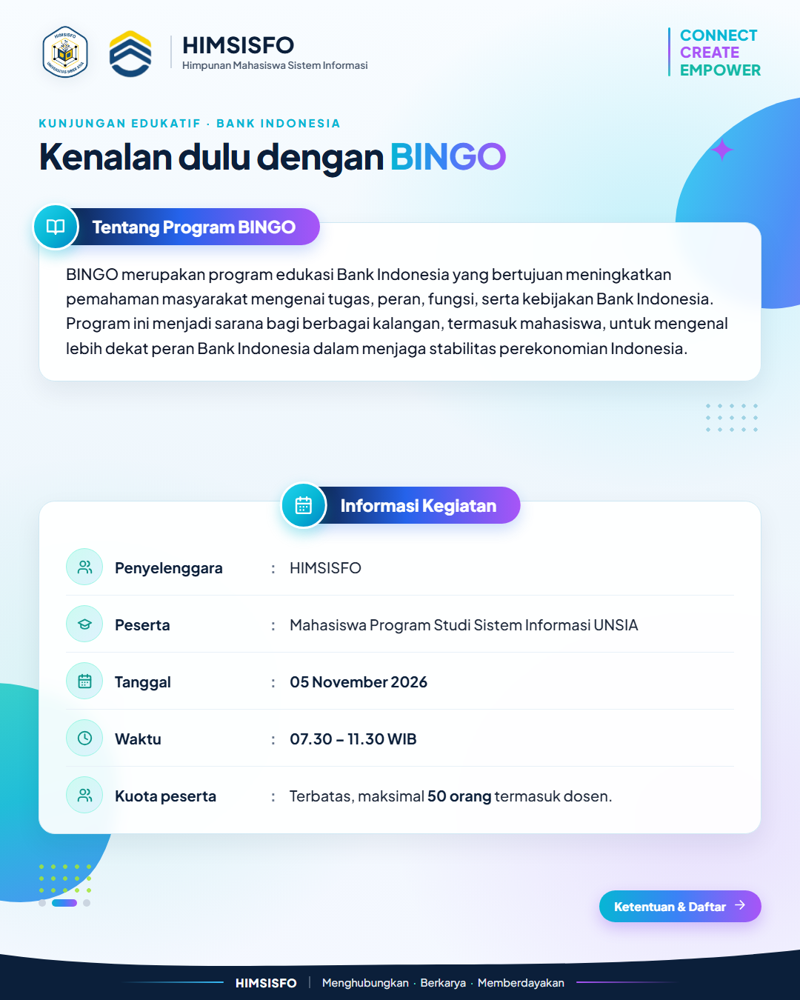
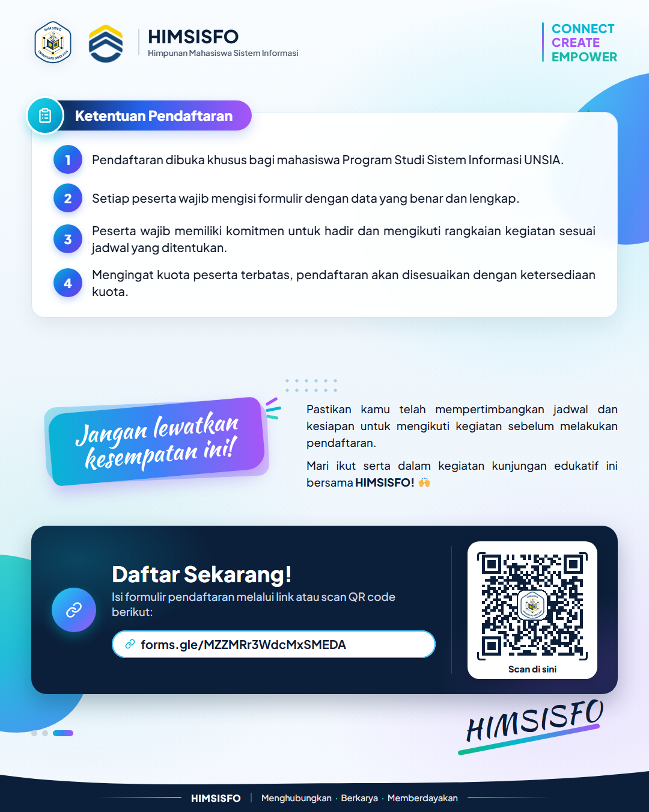

# 🎨 HIMSISFO UNSIA — Design as Code

Repositori pusat desain poster, feed Instagram, base template, dan aset identitas visual **Himpunan Mahasiswa Sistem Informasi — Universitas Siber Asia (HIMSISFO UNSIA)** periode **2026/2027** yang dibangun menggunakan kode (`HTML`, `CSS`, `JavaScript`).

> **Tagline:** *Connect · Create · Empower* (`Menghubungkan · Berkarya · Memberdayakan`)

---

## 🗂️ Arsitektur Repositori

Repositori ini dirancang secara modular dengan 4 bagian utama:

```text
design-as-code/
├── index.html                        # 🌟 Showcase Hub (menampilkan seluruh project, template & palet warna)
├── assets/                           # 1. PUSAT ASET & KONFIGURASI BRAND
│   ├── config.json                   #    Single Source of Truth (data organisasi, palet, registry project)
│   ├── theme.css                     #    Design tokens CSS global (:root warna, gradien, tipografi)
│   ├── logo-himsisfo.png             #    Logo resmi HIMSISFO UNSIA
│   ├── logo-universitas.jpg          #    Logo Universitas Siber Asia
│   └── konsep-tema-hima-2026-2027.pdf#    Panduan konsep visual & palet warna 2026/2027
│
├── templates/                        # 2. BASE TEMPLATES SIAP PAKAI
│   ├── shared/                       #    UI Studio & komponen bersama (header, wave footer, ikon SVG)
│   │   ├── studio.css
│   │   └── studio.js
│   ├── ig-feed-4x5/                  #    Starter template IG Feed 4:5 (1080 × 1350 px)
│   ├── ig-story-9x16/                #    Starter template IG Story / Reels 9:16 (1080 × 1920 px)
│   └── banner-16x9/                  #    Starter template Landscape Banner 16:9 (1920 × 1080 px)
│
└── projects/                         # 3. PROYEK DESAIN KEGIATAN HIMSISFO
    └── kunjungan-edukatif-bi/        #    Poster Kunjungan Edukatif ke Bank Indonesia (Program BINGO)
        ├── index.html                #    Studio preview & kanvas HTML (Single Post & Carousel 3 Slide)
        ├── styles.css                #    Styling proyek (mengimpor ../../templates/shared/studio.css)
        ├── render.ps1                #    Script otomatis render PNG via Microsoft Edge Headless
        ├── assets/                   #    Foto gedung BI & QR code pendaftaran (dengan logo HIMSISFO)
        └── export/                   #    Hasil akhir PNG 1080×1350 siap upload ke Instagram
```

---

## 🚀 Daftar Proyek (`projects/`)

| Proyek | Format | Studio HTML | Hasil Export (PNG) |
| :--- | :--- | :--- | :--- |
| **Kunjungan Edukatif ke Bank Indonesia (BINGO)** | IG Feed `4:5` (`1080×1350`) — Single & Carousel 3 Slide | [`projects/kunjungan-edukatif-bi/`](./projects/kunjungan-edukatif-bi/) | [`projects/kunjungan-edukatif-bi/export/`](./projects/kunjungan-edukatif-bi/export/) |

### Preview: Kunjungan Edukatif ke Bank Indonesia
| Single Post (`4:5`) | Carousel Slide 1 | Carousel Slide 2 | Carousel Slide 3 |
| :---: | :---: | :---: | :---: |
|  |  |  |  |

---

## 🎨 Palet Warna Tema 2026/2027 (`assets/config.json` & `assets/theme.css`)

| Peran | Nama Warna | Hex | Variabel CSS | Penggunaan Utama |
| :--- | :--- | :--- | :--- | :--- |
| **Primary** | Bright Cyan | `#06B6D4` | `var(--cyan)` | Aksen utama, kata `CONNECT`, gradien |
| **Secondary** | Electric Violet | `#A855F7` | `var(--violet)` | Aksen sekunder, kata `CREATE`, gradien |
| **Tertiary** | Fresh Mint | `#2DD4BF` | `var(--mint)` | Aksen ketiga, kata `EMPOWER` |
| **Accent** | Lime Pulse | `#A3E635` | `var(--lime)` | Dot, badge, dan highlight kecil |
| **Dark Base** | Midnight Navy | `#0B1F3A` | `var(--navy)` | Judul utama, footer, dan elemen gelap |
| **Light Base** | Ice White | `#F8FAFC` | `var(--ice)` | Latar belakang utama yang bersih |

---

## 🛠️ Cara Membuat Proyek Desain Baru

1. Salin salah satu folder dari [`templates/`](./templates/) (misalnya `templates/ig-feed-4x5`) ke dalam folder [`projects/`](./projects/) dengan nama kegiatan baru (contoh: `projects/webinar-cyber-security`).
2. Edit konten di dalam `index.html` proyek tersebut.
3. Render otomatis ke PNG `1080×1350` menggunakan PowerShell:
   ```powershell
   pwsh -File ./projects/kunjungan-edukatif-bi/render.ps1
   ```
   atau jalankan local server dari root repositori (`npx serve .`) untuk menggunakan tombol **📋 Copy** dan **⬇ Download PNG** langsung di browser.
4. Daftarkan proyek baru ke dalam [`assets/config.json`](./assets/config.json) agar otomatis tampil di halaman Showcase utama ([`index.html`](./index.html)).

---

## 📄 Lisensi & Hak Cipta Aset

- **Kode Sumber (`HTML`, `CSS`, `JS`, `JSON`, `PowerShell`):** Dilisensikan di bawah [MIT License](./LICENSE).
- **Logo & Identitas Organisasi:** Nama, logo **HIMSISFO UNSIA**, dan logo **Universitas Siber Asia** adalah hak milik resmi masing-masing organisasi/institusi dan tidak diperkenankan disalahgunakan tanpa izin.
