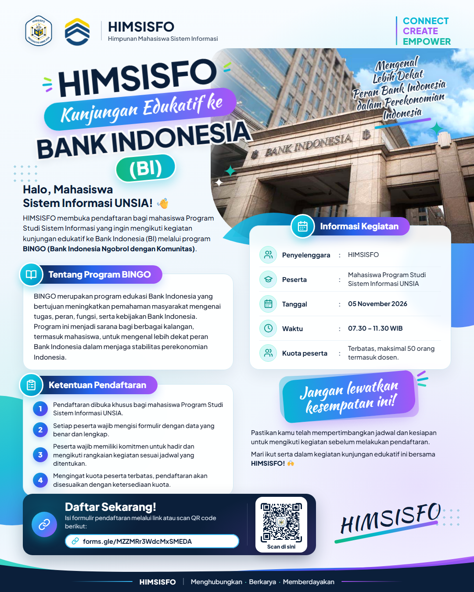
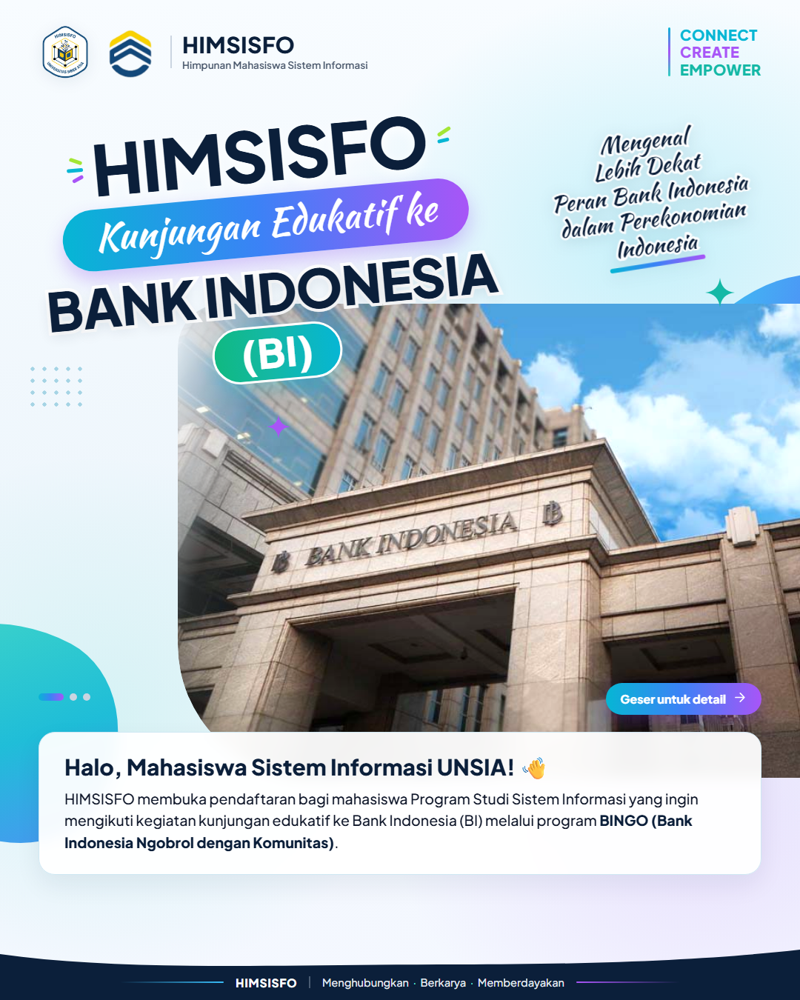

# 🎨 HIMSISFO UNSIA — Design as Code

Kumpulan desain poster, feed Instagram, dan aset visual resmi **Himpunan Mahasiswa Sistem Informasi — Universitas Siber Asia (HIMSISFO UNSIA)** periode **2026/2027** yang dibuat menggunakan kode (`HTML`, `CSS`, `JavaScript`).

> **Tagline:** *Connect · Create · Empower* (`Menghubungkan · Berkarya · Memberdayakan`)

---

## 📁 Daftar Proyek Desain

| Proyek | Format | Direktori | Hasil Export (PNG) |
| :--- | :--- | :--- | :--- |
| **Kunjungan Edukatif ke Bank Indonesia (BINGO)** | IG Feed `4:5` (`1080×1350`) — Single & Carousel 3 Slide | [`kunjungan-edukatif-bi/`](./kunjungan-edukatif-bi/) | [`kunjungan-edukatif-bi/export/`](./kunjungan-edukatif-bi/export/) |

### Preview: Kunjungan Edukatif ke Bank Indonesia
| Single Post (`4:5`) | Carousel Slide 1 | Carousel Slide 2 | Carousel Slide 3 |
| :---: | :---: | :---: | :---: |
|  |  |  |  |

---

## 🎨 Palet Warna Tema 2026/2027

Sesuai panduan [`assets/konsep-tema-hima-2026-2027.pdf`](./assets/konsep-tema-hima-2026-2027.pdf):

| Peran | Nama Warna | Hex | Penggunaan Utama |
| :--- | :--- | :--- | :--- |
| **Primary** | Bright Cyan | `#06B6D4` | Aksen utama, kata `CONNECT`, gradien |
| **Secondary** | Electric Violet | `#A855F7` | Aksen sekunder, kata `CREATE`, gradien |
| **Tertiary** | Fresh Mint | `#2DD4BF` | Aksen ketiga, kata `EMPOWER` |
| **Accent** | Lime Pulse | `#A3E635` | Dot, badge, dan highlight kecil |
| **Dark Base** | Midnight Navy | `#0B1F3A` | Judul utama, footer, dan elemen gelap |
| **Light Base** | Ice White | `#F8FAFC` | Latar belakang utama yang bersih |

---

## 🗂️ Struktur Repositori

```text
.
├── index.html                      # Halaman katalog utama (Design as Code Hub)
├── assets/                         # Base brand assets HIMSISFO UNSIA (dipakai bersama)
│   ├── logo-himsisfo.png           # Logo resmi HIMSISFO UNSIA
│   ├── logo-universitas.jpg        # Logo Universitas Siber Asia
│   └── konsep-tema-hima-2026-2027.pdf
└── kunjungan-edukatif-bi/          # Proyek poster Kunjungan Edukatif ke Bank Indonesia
    ├── index.html                  # Studio preview & export (Single Post & Carousel 3 Slide)
    ├── styles.css                  # Design tokens & layout 1080x1350
    ├── script.js                   # Komponen header/footer, ikon SVG, & tombol export PNG
    ├── render.ps1                  # Script otomatis render PNG via Microsoft Edge Headless
    ├── assets/                     # Foto gedung BI & QR code pendaftaran
    └── export/                     # Hasil akhir PNG 1080x1350 siap upload ke Instagram
```

---

## 🚀 Cara Menggunakan & Export ke PNG

### 1. Lewat Browser (Live Server)
Jalankan local web server dari **root repositori** (agar aset logo di root dapat dimuat oleh tiap subfolder proyek):
```bash
npx serve .
```
Lalu buka `http://localhost:3000/kunjungan-edukatif-bi/` di browser dan gunakan tombol **📋 Copy** atau **⬇ PNG** di atas masing-masing slide.

### 2. Render Otomatis via PowerShell (Headless Edge)
Untuk me-render ulang seluruh slide menjadi PNG berukuran presisi `1080×1350`:
```powershell
pwsh -File ./kunjungan-edukatif-bi/render.ps1
```

---

## 📄 Lisensi & Hak Cipta Aset

- **Kode Sumber (`HTML`, `CSS`, `JS`, `PowerShell`):** Dilinsensikan di bawah [MIT License](./LICENSE). Anda bebas mempelajari, memodifikasi, dan menggunakan struktur kode di repositori ini sebagai referensi.
- **Logo & Identitas Organisasi:** Nama, logo **HIMSISFO UNSIA**, dan logo **Universitas Siber Asia** adalah hak milik resmi masing-masing organisasi/institusi dan tidak diperkenankan digunakan untuk mengatasnamakan organisasi tanpa izin.
